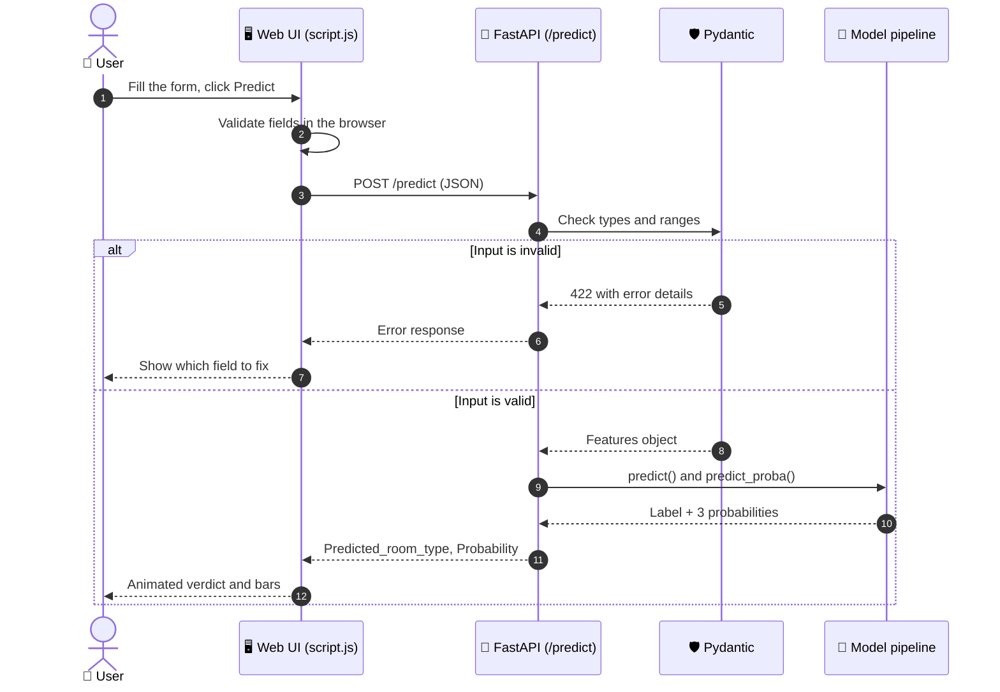
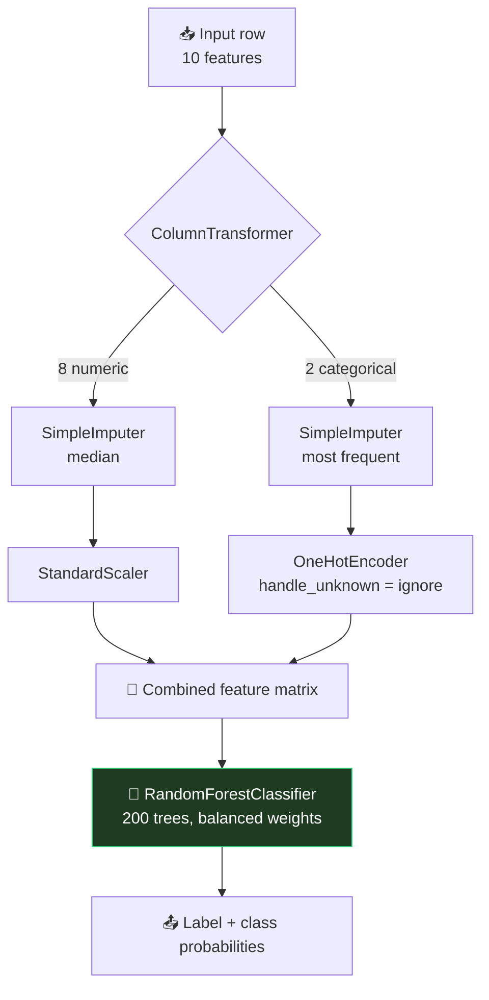

<div align="center">


<a href="https://github.com/your-username/your-repo">
  
</a>

<br/>


**[Overview](#-overview) · [Demo](#-demo) · [Workflow](#-workflow) · [Structure](#-project-structure) · [Model](#-the-model) · [API](#-api-reference) · [Run it](#-getting-started) · [Roadmap](#-roadmap)**

</div>

---

## 🧭 Overview

**NYC Stay Type Predictor** classifies a New York Airbnb listing into one of three room types from its location, price, booking rules and review activity:

| Class | Line colour in the UI | Meaning |
|:--|:-:|:--|
| 🔴 **Entire home/apt** | red | The guest gets the whole place |
| 🔵 **Private room** | blue | A private room inside a shared home |
| 🟢 **Shared room** | green | The guest shares the sleeping space |

The project covers the full path from raw data to a working product:

1. Explore and clean the public NYC Airbnb 2019 dataset in a notebook.
2. Build and compare four classifiers inside one scikit-learn pipeline.
3. Tune the best model and save it as a single `.pkl` file.
4. Serve it through a validated **FastAPI** endpoint.
5. Use it from an animated, subway-inspired **web interface**.

---

## 🎬 Demo

LINK : nyc-airbnb-room-type-predictor-isxj-e0uh8gabx-trinetra5.vercel.app


## 🔄 Workflow

### End-to-end pipeline

```mermaid
flowchart LR
    A[("🗂️ Kaggle dataset<br/>AB_NYC_2019.csv")] --> B["🔍 EDA<br/>distributions, correlations, map"]
    B --> C["🧹 Cleaning<br/>drop columns, fill gaps, cap outliers"]
    C --> D["✂️ Stratified split<br/>67% train / 33% test"]
    D --> E["⚙️ Preprocessing<br/>impute, scale, one-hot"]
    E --> F["🤖 Compare 4 models<br/>3-fold CV"]
    F --> G["🎯 Tune Random Forest<br/>RandomizedSearchCV"]
    G --> H["📈 Evaluate<br/>accuracy, macro F1, confusion matrix"]
    H --> I[("💾 Model_Pipeline.pkl")]
    I --> J["🚀 FastAPI<br/>main.py"]
    J --> K["🖥️ Web UI<br/>index.html, style.css, script.js"]

    style A fill:#1b2540,stroke:#4a8dff,color:#fff
    style I fill:#1b2540,stroke:#2fd47c,color:#fff
    style J fill:#0b3d3a,stroke:#009688,color:#fff
    style K fill:#3a1d1c,stroke:#ff4d45,color:#fff
```



### What happens when you press **Predict**



### Inside the model pipeline



---

## 🗂️ Project structure

```text
nyc-stay-type-predictor/
│
├── 📓 Code.ipynb          # EDA, cleaning, model comparison, tuning, export
├── 🚀 main.py             # FastAPI app: validation + /predict endpoint
├── 💾 Model_Pipeline.pkl  # Trained scikit-learn pipeline (preprocessing + model)
│
├── 🌐 index.html          # Page structure
├── 🎨 style.css           # Theme, layout, transitions and animations
├── ⚡ script.js           # Map canvas, form logic, API calls, result animation
│
├── 📦 requirements.txt    # Python dependencies (see below)
└── 📖 README.md
```

<details>
<summary><b>📁 What each file does</b> (click to expand)</summary>

<br/>

| File | Role |
|:--|:--|
| `Code.ipynb` | Downloads the dataset with `kagglehub`, explores it, cleans it, trains and compares models, tunes the best one and saves it with `joblib`. |
| `Model_Pipeline.pkl` | One object that holds the preprocessing and the tuned Random Forest, so raw input can go straight in. |
| `main.py` | Loads the pipeline once at startup, validates input with Pydantic, returns the label and probabilities. CORS is open so the page can call it. |
| `index.html` | Form, map panel and result panel. |
| `style.css` | Dark theme with subway-line colours, slider styling, button shine, result transitions, responsive rules and reduced-motion support. |
| `script.js` | Borough and neighbourhood data, canvas map and marker, validation, `fetch` call, error handling, count-up and bar animations, API status dot. |

</details>

---

## 🤖 The model

### Dataset

- **Source:** [New York City Airbnb Open Data](https://www.kaggle.com/datasets/dgomonov/new-york-city-airbnb-open-data) on Kaggle (`AB_NYC_2019.csv`)
- **Size:** 48,895 listings, 16 columns
- **Target:** `room_type` with 3 classes

### Features used

| Feature | Type | What it means |
|:--|:-:|:--|
| `latitude`, `longitude` | numeric | Exact location |
| `price` | numeric | Price per night in USD |
| `minimum_nights` | numeric | Minimum booking length |
| `number_of_reviews` | numeric | Total reviews |
| `reviews_per_month` | numeric | Review rate |
| `calculated_host_listings_count` | numeric | How many listings the host has |
| `availability_365` | numeric | Days available in a year |
| `neighbourhood_group` | categorical | Borough |
| `neighbourhood` | categorical | Neighbourhood |

### Cleaning steps

| Step | Why |
|:--|:--|
| Drop `id`, `name`, `host_id`, `host_name`, `last_review` | They identify a listing but do not describe it |
| Fill missing `reviews_per_month` with `0` | A missing value means the listing has no reviews yet |
| Cap `price` and `minimum_nights` at the 99th percentile | Limits extreme outliers without deleting rows |
| Stratified 67/33 train–test split (`random_state=42`) | Keeps the class balance equal in both sets |

### Model comparison (3-fold cross-validation on the training set)

Accuracy alone can mislead when one class is rare, so **macro F1** (which treats every class equally) was tracked as well. Shared rooms are rare, which is why `class_weight="balanced"` was used where the model supports it.

| Model | Accuracy | Macro F1 | Accuracy bar |
|:--|:-:|:-:|:--|
| Logistic Regression | 0.659 | 0.522 | `██████░░░░` |
| Decision Tree | 0.782 | 0.647 | `████████░░` |
| 🏆 **Random Forest** | **0.851** | **0.715** | `█████████░` |
| Gradient Boosting | 0.850 | 0.705 | `█████████░` |

### Tuning

`RandomizedSearchCV` (10 iterations, 3 folds, scored on macro F1) searched `n_estimators`, `max_depth` and `min_samples_split`.

| Setting | Best value |
|:--|:-:|
| `n_estimators` | 200 |
| `min_samples_split` | 10 |
| `max_depth` | `None` |
| Best CV macro F1 | 0.731 |

### Final test results

| Metric | Score |
|:--|:-:|
| Accuracy | **0.855** |
| Macro F1 | **0.740** |

---

## 🔌 API reference

The backend exposes two routes. FastAPI also generates interactive docs at **`/docs`** (Swagger UI) and **`/redoc`**.

### `GET /`
Health check. Returns a greeting string. The web UI uses it to light the green or red status dot.

### `POST /predict`

**Request body**

```json
{
  "latitude": 40.7233,
  "longitude": -74.0030,
  "price": 320,
  "minimum_nights": 3,
  "number_of_reviews": 41,
  "reviews_per_month": 1.4,
  "calculated_host_listings_count": 1,
  "availability_365": 210,
  "neighbourhood_group": "Manhattan",
  "neighbourhood": "SoHo"
}
```

**Response**

```json
{
  "Predicted_room_type": "Entire home/apt",
  "Probability": [0.91, 0.08, 0.01]
}
```

> The probabilities follow the model's class order, which is alphabetical:
> `["Entire home/apt", "Private room", "Shared room"]`

<details>
<summary><b>✅ Validation rules</b> (click to expand)</summary>

<br/>

| Field | Rule |
|:--|:--|
| `latitude` | number from -90 to 90 |
| `longitude` | number from -180 to 180 |
| `price` | number greater than 0 |
| `minimum_nights` | integer from 1 to 365 |
| `number_of_reviews` | integer, 0 or more |
| `reviews_per_month` | number, 0 or more |
| `calculated_host_listings_count` | integer, 0 or more |
| `availability_365` | integer from 0 to 365 |
| `neighbourhood_group` | non-empty text |
| `neighbourhood` | non-empty text |

Invalid input returns **HTTP 422** with the field name and the problem.

</details>

<details>
<summary><b>🧪 Try it from the command line</b> (click to expand)</summary>

<br/>

```bash
curl -X POST http://127.0.0.1:8000/predict \
  -H "Content-Type: application/json" \
  -d '{
    "latitude": 40.7233, "longitude": -74.0030, "price": 320,
    "minimum_nights": 3, "number_of_reviews": 41, "reviews_per_month": 1.4,
    "calculated_host_listings_count": 1, "availability_365": 210,
    "neighbourhood_group": "Manhattan", "neighbourhood": "SoHo"
  }'
```

</details>

---

## 🚀 Getting started

### 1. Clone the repository

```bash
git clone https://github.com/your-username/your-repo.git
cd your-repo
```

### 2. Create an environment and install dependencies

```bash
python -m venv venv
source venv/bin/activate        # Windows: venv\Scripts\activate
pip install -r requirements.txt
```

Create `requirements.txt` with:

```text
fastapi
uvicorn
pandas
scikit-learn
joblib
pydantic
```

> ⚠️ **Pin your scikit-learn version.** A `.pkl` file only loads reliably with the same scikit-learn version it was trained with. Run `pip show scikit-learn` in the environment where you trained it and write that version in `requirements.txt` (for example `scikit-learn==1.x.x`).

### 3. Start the API

```bash
uvicorn main:app --reload
```

The API runs at `http://127.0.0.1:8000`. Open `http://127.0.0.1:8000/docs` to test it.

### 4. Open the interface

Open `index.html` in your browser. If your API runs on another address, change it in the **API connection** panel at the bottom of the page.

### 5. Retrain the model (optional)

Open `Code.ipynb` and run all cells. The last cell saves a fresh `Model_Pipeline.pkl`.

---

## 🧯 Troubleshooting

<details>
<summary><b>The page says “Couldn’t reach the model”</b></summary>

<br/>

- Check that `uvicorn main:app --reload` is running.
- Check the URL in **API connection**. The dot turns green when the server answers.
- Open the browser console (F12) for the exact network error.

</details>

<details>
<summary><b>The server fails when loading <code>Model_Pipeline.pkl</code></b></summary>

<br/>

This usually means the scikit-learn version differs from the one used for training. Install the matching version, or retrain by running `Code.ipynb` in your current environment.

</details>

<details>
<summary><b>I get a 422 error</b></summary>

<br/>

One of the values breaks a validation rule. See the table under **Validation rules**. The message names the field.

</details>

<details>
<summary><b>My neighbourhood is not in the dropdown</b></summary>

<br/>

The page lists about 70 well-known neighbourhoods. To add more, extend the `n` strings inside `BOROUGHS` in `script.js`, using the format `Name,latitude,longitude` separated by `|`. The model ignores neighbourhood names it has not seen, so predictions still work.

</details>

---

## 🛠️ Tech stack

| Layer | Tools |
|:--|:--|
| Data and ML | Python, Pandas, NumPy, scikit-learn, Matplotlib, Seaborn, kagglehub |
| Serving | FastAPI, Pydantic, Uvicorn, joblib |
| Frontend | HTML5, CSS3, vanilla JavaScript, Canvas API, Google Fonts |

---

## 🧗 Limitations

- The data is from **2019**, so prices and listing mix may have shifted.
- **Shared rooms are rare**, so that class is the hardest to predict (see the macro F1 of 0.74 against accuracy of 0.86).
- The model only knows New York City.

---

## 🗺️ Roadmap

- [x] Data cleaning and EDA
- [x] Model comparison and tuning
- [x] FastAPI backend with validation
- [x] Interactive web interface
- [ ] Add confusion-matrix and feature-importance views to the UI
- [ ] Add a clickable map to pick the location
- [ ] Docker image for one-command setup
- [ ] Deploy the API and host the frontend online
- [ ] Automated tests for the API

---

## 🤝 Contributing

Contributions are welcome.

1. Fork the repository
2. Create a branch: `git checkout -b feature/my-idea`
3. Commit your changes: `git commit -m "Add my idea"`
4. Push the branch: `git push origin feature/my-idea`
5. Open a pull request

---

## 📄 License

Distributed under the MIT License. Add a `LICENSE` file to the repository root to make it official.

## 🙏 Acknowledgements

- Dataset by [Dgomonov](https://www.kaggle.com/dgomonov) on Kaggle
- Banner by [capsule-render](https://github.com/kyechan99/capsule-render) and typing text by [readme-typing-svg](https://github.com/DenverCoder1/readme-typing-svg)

<div align="center">

<br/>

**If this project helped you, give it a ⭐**


</div>
